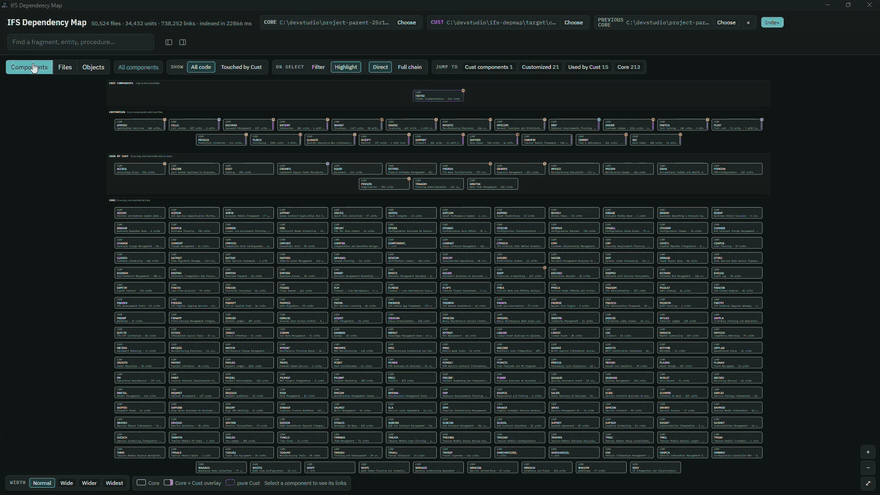

<p align="center">
  
</p>
<p align="center"><a href="https://phbronson999.github.io/ifs-dependency-map/">Try it in your browser</a> (sample data, nothing to install)</p>

# IFS Dependency Map

Indexes an IFS Cloud **Core** folder and a **Cust** folder into one dependency
graph, shows it at three zoom levels (components → files → objects), and flags
the things that get in the way, like circular fragment includes.

It is read-only. It never writes to the folders it indexes. Each finding links to
the file and line, shows an example of the fix and, under *How this was found*,
the source lines that led to it, with any step that rests on an assumption marked.
Findings that involve only Core files are hidden by default (Core can't be
changed and compiles as delivered); the *Core only* chip shows them.

## Install (Windows)

Download `IFS.Dependency.Map_<version>_x64-setup.exe` from the
[latest release](https://github.com/phbronson999/ifs-dependency-map/releases/latest) and run it.
No Rust or Node is needed. The `.msi` there does the same for managed installs.

- The installer isn't code-signed, so Windows SmartScreen says "Windows protected your PC" the
  first time: choose **More info → Run anyway**.
- It uses Microsoft Edge WebView2, which Windows 10 and 11 normally already have; the installer
  fetches it if it's missing.
- In the app, choose your Core and Cust folders (and, for upgrades, the previous Core), then
  **Index**. "Open" buttons use VS Code's `code` command, so VS Code must be on the PATH.
- For an AI assistant such as Claude Code, releases after 0.2.0 also have `ifsdep-ai.exe`: a single
  file with nothing to install and no need for the desktop app. Put it anywhere and see
  [Use with an AI assistant](#use-with-an-ai-assistant).

## What it checks

| Rule | Severity | What it means |
|---|---|---|
| `CYCLE` | error | `include fragment` chains that loop. Marked *appears with Cust layer* when the loop only exists once Cust overlays are applied; Core-only loops are reported but no fix is suggested. |
| `DUPLICATE_DEFINITION` | error | The same construct (structure, entity, function…) reaches one client/projection from two different units. |
| `MISSING_OVERRIDE` | error | A `-Cust` overlay redeclares a Core construct without `@Override`. |
| `CONNECTION_MISSING` | warning | A cross-component include or `Xxx_API` call with no `[Connections]` entry in deploy.ini. |
| `DYNAMIC_NOT_GUARDED` | warning | A DYNAMIC connection used without `@DynamicComponentDependency` or a `$IF Component_X_SYS.INSTALLED` guard. |
| `LAYER_MISMATCH` | warning | `layer Cust;` in the Core folder, or `layer Core;` in the Cust folder. |
| `OVERRIDE_NO_BASE` | warning / info | `@Override`/`@Overtake` with nothing to layer over (info for projection entities, whose base may be an LU `.entity`). |
| `UNRESOLVED_INCLUDE` / `UNRESOLVED_PROJECTION` | warning | Name not found in either folder. |
| `COLUMN_AMBIGUOUS` | error | A Cust attribute (or Cust `@Override VIEW` column) gives a view or table a column that a query uses without an alias prefix, while another relation in the same FROM already has it: the query no longer compiles (ORA-00918). Only SQL in `.plsql`, `.plsvc` and `.views` files is checked. |
| `DATATYPE_MISMATCH` | error / warning | A derived attribute's declared `DATATYPE` / `LENGTH` doesn't match where its value comes from, followed through `DB_SQL_IMPLEMENTATION`, an association's `USE_DEFINITION` or the LU's hand-written view, then function `RETURN` types, `%TYPE`s, table columns and entity attributes. Error when the type differs (a number column filled with text fails with ORA-06502), warning when the declared length is shorter. A public attribute is a field of the generated `Get()`'s record, so the finding counts every caller of `Get()` and shows a path to it from a view. |
| `BASE_CHANGED` | error / warning / info | With a previous Core: the Core declaration an `@Override` / `@Overtake` (or Cust `@Override VIEW`) layers over changed. Shows the diff of just that declaration. Error when its signature changed and yours still has the old one; warning under an `@Overtake` (your copy replaces IFS's new code); info otherwise. |
| `ENTITY_CHANGED` | warning / info | With a previous Core: the Core `.entity` under a `-Cust.entity` gained, lost or changed attributes; a warning when Core now has an attribute your Cust entity also declares. |

## How Core and Cust are modeled

- **Layer comes from the folder.** Everything under the Core folder is Core;
  everything under the Cust folder is Cust.
- **Unit** = a logical name. `ShopOrderCommon.fragment` (Core) and
  `ShopOrderCommon-Cust.fragment` (Cust) are one unit with an *overlay*.
- A `-Cust` file with no Core counterpart is a **pure Cust** unit; its
  generated base is the base for any `@Override` of its constructs.
- **Core never depends on Cust.** Core is IFS's delivered code, so names in Core
  files only resolve against Core.
- `@Override` resolves to whichever base exists, Core or pure Cust, preferring
  the same unit, then what the unit includes. When no file declares the base, it
  is generated from the model (`.entity` / `.projection`), as for every Core
  override of `Insert___`, `CRUD_Create___` or a getter.
- Other names (calls, references, bindings) resolve in the same unit, then what
  it includes, then what the client or projection it ends up in includes.
- deploy.ini `[Connections]` from the Core and Cust copies of a component are
  combined.

## Object links (Objects view)

The Objects view follows these links downward as far as they go:

| Link | Found from |
|---|---|
| client construct → projection object | `for` / `using` |
| command → action/function | `call ReleaseOrder(...)` |
| entityset → entity | `entityset X for Y` |
| entity → entity / enumeration | `reference`, `array`, `Enumeration(X)` |
| action/function → .plsvc method | IFS naming: `ReleaseOrder` → `Release_Order___` |
| method → method | `Xxx_API.Method(...)`, same-package `Method___(...)`, and `fetch = "Xxx_API.M(...)"` |
| override → base | `@Override` / `@Overtake` |
| call → generated method | `Xxx_API.Get()`, `Get_<Attr>()` and `Get_<Attr>_Db()` are generated from the LU's `.entity` (public attributes, unless `EXCLUDE_GET_METHOD`); they point at the entity and call what their derived attributes' implementations call. A getter and a hand-written method of the same name are overloads |
| entity/query/method → table or view | `from = "view"`, `FROM` / `JOIN` / `UPDATE` / `INSERT INTO` in SQL (including `FROM a x, b y` lists; `WITH` names are left out) |
| view → table or view, method | the view's `SELECT` in a `.views` file |
| generated view → generated table | the `.entity`: the LU name in snake case (every capital starts a word: `JobKPI` → `JOB_K_P_I`), plus `_TAB`, unless `DB_VIEW_NAME` / `DB_TABLE_NAME` rename them (none for `abstract` LUs) |

A call into a method that Cust overrides lands on the override, then follows
`@Override` to the Core base. Each table and view shows where it is defined: a
`.views` or `.storage` statement (`TABLE`, `TEMPORARY TABLE`), a table created by a
PL/SQL block in `.storage`, `.cre` or `.cdb` (`table_name_ := 'X_TAB'` then
`Create_Table`, `Create_Temporary_Table('X', …)`, `'CREATE GLOBAL TEMPORARY TABLE x'`),
or the `.entity` it is generated from.

## Views

- **Components** are in bands: Cust components, Core components with Cust files,
  Core components that Cust code links to, and the rest. Each band is alphabetical
  and shows the deploy.ini description. Select one to see its links.
- **Objects** are in bands from the client down to the database, and within a band
  each file is a box (tables and views are boxed by the LU that defines them),
  with the file's overrides on the row above their bases.
- **Show: Touched by Cust** limits every view to what's declared in Cust files and
  what Cust code overrides, includes, calls or reads.

## Trace

Select a procedure or function in **Objects** and click **Trace** to follow what it
does, in the order it runs: its calls, the tables and views it reads, its writes
(INSERT / UPDATE / DELETE / MERGE), the errors it raises, and its RETURNs (plus EXIT /
CONTINUE in loops), numbered top to bottom. Steps after a RETURN on the branches you
picked are dimmed: they don't run on that path.

- At each **◆** branch (IF / ELSIF / ELSE, CASE, exception handlers) pick a branch to
  see inside it. An IF with no ELSE also offers "No ELSE: nothing runs". The trace goes
  on after the branch either way.
- **+** on a call opens the method it calls in place. **Trace from it** opens it as a
  trace of its own in a column to the right, linked to the call. Traces from the same
  column stack; drag one by its top step to move it. **Start over** goes back to the
  first method alone.
- What runs in a loop sits in a shaded box and is marked **↻ in a loop**.
- A call to a method with a Cust `@Override` goes to the override, since that's what
  runs. `$IF Component_X_SYS.INSTALLED` lines are skipped and the code inside them traced.
- The **Steps** chips show or hide calls, reads, writes, errors and returns.

Trace reads the source files, so it works in the desktop app only. The CLI prints the
same thing: `ifsdep --trace <file.plsql> <line>`.

## Use with an AI assistant

The full index is far too big for an AI assistant to read (about 250 MB of JSON on a
whole Core). `ifsdep-ai init` gives it a version it can ask questions of instead.
Run it in the folder you start Claude Code in, and only when you want to:

```sh
ifsdep-ai init --core <dir> --cust <dir> [--prev-core <dir>] [--workspace <dir>]
```

For example, for a Developer Studio project in `C:\devstudio` with Core 25R1, its Cust
workspace and the previous Core (23R2) for the upgrade checks:

PowerShell:

```powershell
& "C:\tools\ifsdep-ai.exe" init `
    --core "C:\devstudio\project-parent-25r1\core-files\25.1.16\checkout" `
    --cust "C:\devstudio\project-parent-25r1\RU-releaseUpdate\workspace" `
    --prev-core "C:\devstudio\project-parent-23r2\core-files\checkout\checkout" `
    --workspace "C:\devstudio"
```

Command Prompt (cmd):

```bat
"C:\tools\ifsdep-ai.exe" init ^
    --core "C:\devstudio\project-parent-25r1\core-files\25.1.16\checkout" ^
    --cust "C:\devstudio\project-parent-25r1\RU-releaseUpdate\workspace" ^
    --prev-core "C:\devstudio\project-parent-23r2\core-files\checkout\checkout" ^
    --workspace "C:\devstudio"
```

Use the path where you saved `ifsdep-ai.exe`. Leave out `--prev-core` if you aren't
upgrading. This writes `C:\devstudio\ifsdep-ai.idx` and
`C:\devstudio\.claude\skills\ifs-codebase\SKILL.md`, so start Claude Code in `C:\devstudio`.

It indexes the folders (about half a minute on a full Core) and writes two things into
the workspace (the current folder unless you pass `--workspace`):

- `ifsdep-ai.idx`, a compact copy of the index (about 90 MB for 25R1 Core plus Cust).
- `.claude/skills/ifs-codebase/SKILL.md`, a skill that Claude Code loads in that folder.
  It tells Claude when to use the queries below instead of grep, gives the full paths of
  `ifsdep-ai.exe` and the index, and lists the IFS rules the index follows (layers,
  overrides, generated methods).

Nothing else writes these two files: not indexing, and not the desktop app. Run it again
to refresh them after the code changes. It won't write inside the IFS folders. The
queries each take about a second:

| Command | Answers |
|---|---|
| `ifsdep-ai find <name>` | where it's defined in Core and Cust, and what it overrides or is overridden by |
| `ifsdep-ai callers <name> [--depth N]` | what links to it (calls, includes, binds, reads), Cust first |
| `ifsdep-ai callees <name> [--depth N]` | what it links to |
| `ifsdep-ai impact <name> [--depth N]` | every unit a change reaches, nearest first, Cust first |
| `ifsdep-ai unit <name>` | a unit's files in both layers, what Cust adds or overrides, its links and findings |
| `ifsdep-ai trace <Package_API.Method>` | what Trace shows, with where each call is defined |
| `ifsdep-ai findings [--file …] [--unit …] [--rule …] [--cust]` | the findings, with the suggested fix |
| `ifsdep-ai status` | whether files changed since the index was written |

`<name>` is `Unit.Object` (`Customer_Order_API.Get_Customer_Po_No`), a unit, an object, or a
table or view, in any case. When nothing matches, the answer lists close names, ignoring
underscores (`CustomerOrder` finds `Customer_Order_API`). Every answer gives full
`path:line` locations. The index is looked for in `--index`, then `IFSDEP_INDEX`, then
in the current folder and the folders above it.

## Saved index

The desktop app saves each index in its own data folder
(`%APPDATA%\dev.bronson.ifsdepmap`, never in the folders it reads). The next launch shows
it straight away, then checks every file's size and modified time: if nothing changed
that's it; if something did, it reindexes in the background while you keep working on the
saved one, and the strip under the header says which you're looking at. **Overview** shows
when it was saved, its size, and **Open folder**. An index saved by another version of the
app isn't reused.

## Upgrades

Set **previous Core** (the third folder in the app, or `--prev-core`) to an older Core
checkout, or to the Impact Analyzer's `Base` folder, and every Cust customization is
compared with what it sits on: the declaration it overrides or overtakes, the Core view
under a Cust `@Override VIEW`, and the Core `.entity` under a `-Cust.entity`. Unlike
the Impact Analyzer, it follows each override to its actual base, which is often in
another file (a list declared in a fragment the client includes), shows what changed,
and ignores changes to comments and layout.

## Layout

The project lives in `ifs-depmap/`:

```
ifs-depmap/
  crates/ifsdep-core/   Rust indexer + rules, std only (no crates)
    src/marble.rs       .client / .projection / .fragment parser
    src/plsql.rs        .plsql / .plsvc scanner (methods, Xxx_API calls, guards)
    src/deployini.rs    deploy.ini
    src/entity.rs       .entity: names, renames, attributes
    src/db.rs           .views / .storage / .cre / .cdb: views, tables, columns
    src/sqlscope.rs     SQL query blocks: FROM items and unprefixed names
    src/build.rs        units, name resolution, edges
    src/analyze.rs      the rules above
    src/upgrade.rs      comparison with a previous Core
    src/trace.rs        one method's steps in run order, by branch (Trace view)
    src/stamp.rs        each file's size and modified time, saved with the index
    src/ai.rs           AI index (ifsdep-ai init) and its queries
    src/ai_skill.md     the ifs-codebase skill that ifsdep-ai init fills in
    src/bin/ifsdep.rs   CLI
    tests/fixtures.rs   end-to-end tests
    tests/ai.rs         AI index and queries
  fixtures/core, fixtures/cust   sample folders with every problem planted
  fixtures/prev-core   an older Core for the upgrade tests
  assets/              README hero (GIF)
  ui/                   TypeScript UI, no runtime dependencies (own SVG renderer + layered layout)
  src-tauri/            Tauri 2 shell: folder picker, indexing, open in VS Code
```

## Releasing

Releases are built on a Windows machine and published with the GitHub CLI:

1. Bump `version` in `ifs-depmap/src-tauri/tauri.conf.json` and `ifs-depmap/src-tauri/Cargo.toml`.
2. In `ifs-depmap/`, `npm run tauri build`; the installers land in `src-tauri/target/release/bundle/nsis/` (`.exe`)
   and `bundle/msi/` (`.msi`).
3. Build the AI tool on its own, with the C runtime linked in so it runs on a PC without the
   Visual C++ runtime (and ignores one that's installed):
   `RUSTFLAGS="-C target-feature=+crt-static" cargo build --release --bin ifsdep-ai --target-dir target/static`
   gives `target/static/release/ifsdep-ai.exe`. The separate target folder keeps the flag out of
   the normal builds and the desktop app.
4. Tag and push: `git tag vX.Y.Z && git push origin vX.Y.Z`.
5. `gh release create vX.Y.Z --repo phbronson999/ifs-dependency-map --title "vX.Y.Z" --notes-file <notes>`
   with both installers and `ifsdep-ai.exe` as assets; it becomes the latest release that the Install link above points to.

## Building from source

From `ifs-depmap/`:

```sh
cargo test                                         # 58 tests
cargo run --bin ifsdep -- --core <dir> --cust <dir> [--prev-core <dir>] [--json graph.json] [--strict]
cargo run --bin ifsdep -- --trace <file.plsql> <line>   # what Trace shows for the method on that line
cargo build --release --bin ifsdep-ai              # target/release/ifsdep-ai.exe, the AI tool

npm install                                        # typescript + tauri cli
npm run tauri dev                                  # desktop app
npm run tauri build                                # installers in src-tauri/target/release/bundle/
npm run demo                                       # ui/dist/demo.html with the sample data embedded
npm run pages                                      # the same page as docs/index.html, the GitHub Pages demo
```

The desktop app remembers the two folders. "Open" on any file runs
`code -g path:line`, so the VS Code `code` command must be on your PATH.

## Not done yet

What's missing or planned is tracked in [GitHub issues](https://github.com/phbronson999/ifs-dependency-map/issues);
add new ones there. At the time of writing:

- [#6](https://github.com/phbronson999/ifs-dependency-map/issues/6) `.entity` state machines and `.enumeration` files
- [#7](https://github.com/phbronson999/ifs-dependency-map/issues/7) tables generated for projection `virtual`s (`*_VRT`)
- [#8](https://github.com/phbronson999/ifs-dependency-map/issues/8) `lov X with ReferenceYSelector` links
- [#9](https://github.com/phbronson999/ifs-dependency-map/issues/9) persisted index with incremental rescans
- [#10](https://github.com/phbronson999/ifs-dependency-map/issues/10) more places for DATATYPE_MISMATCH to list
